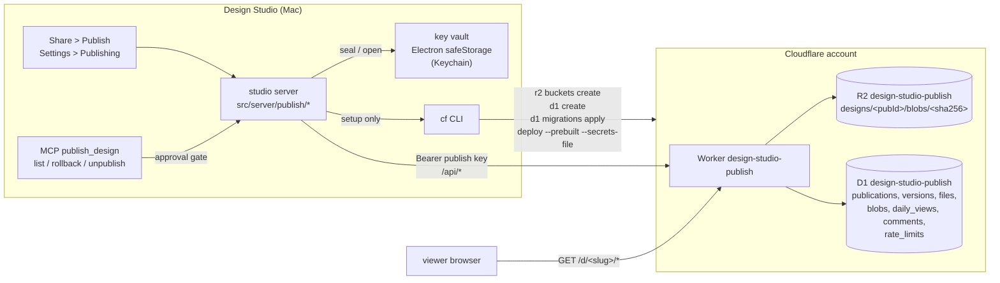

# ADR 0001: One publish Worker for all published designs

Status: accepted, 2026-10-31

## Context

Publish (commits b9ef4e0 to 5c31f9e) deploys one Cloudflare Worker with static assets for each published design (`cf deploy --prebuilt`). This has problems:

- Each publish and each republish uploads the full bundle and makes a new Worker. Accounts have a Worker limit.
- Password, end date and title are compiled into the Worker script. A change needs a new deploy.
- The studio keeps the only record of what is live. There are no versions, no rollback and no view counts.
- Unpublish must delete a Worker. A failed delete leaves a live site.

## Decision

Deploy one Worker app, `design-studio-publish`, once per Cloudflare account. It serves every published design from R2 and keeps metadata in D1. The studio talks to it over HTTPS with a publish key.



### Worker

- Source: `cloud/publish-worker/` (TypeScript, own `package.json` and `tsconfig.json`, own typecheck).
- The studio bundles `src/index.ts` with esbuild into Build Output (`.cloudflare/output/v0/workers/default/bundle/worker.js` plus `worker.config.json`) and runs `cf deploy --prebuilt`. We do not use `wrangler.jsonc`: cf ignores Wrangler config, and without `cloudflare.config.ts` cf auto-configures the folder and installs packages. A prebuilt deploy needs no Node toolchain on the user's Mac.
- Bindings: `DB` (D1, by id), `FILES` (R2, by name), `PUBLISH_KEY_HASH` (secret).
- Routes:
  - Viewer: `GET|HEAD /d/:slug/*`, `GET|HEAD /d/:slug/~k/:pass/*`, `POST /d/:slug/~/unlock`, `GET|POST /d/:slug/~/comments`, `GET /robots.txt`.
  - Studio (publish key): `GET /api/health`, `GET /api/publications`, `POST /api/publications`, `POST /api/publications/:id/versions`, `PUT /api/publications/:id/blobs/:sha256`, `POST /api/publications/:id/versions/:vid/commit`, `POST /api/publications/:id/rollback`, `POST /api/publications/:id/revoke`, `GET /api/publications/:id/comments`, `DELETE /api/publications/:id/comments/:cid`.

### Storage

- R2 keys are content-addressed per publication: `designs/<publicationId>/blobs/<sha256>`. A blob is immutable once uploaded. The upload passes `sha256` to `R2Bucket.put`, so R2 rejects a body that does not match.
- D1 table `files(version_id, path, sha256, size, content_type)` maps each path of a version to a blob. Per-version prefixes would force a full upload on each republish, and the R2 binding cannot copy objects.
- The viewer looks a path up in `files` by exact match. A path can never reach an R2 key that is not in that version. The Worker also refuses `..`, `\`, NUL, encoded slashes and dot segments with 400 before the lookup.
- Migrations: `cloud/publish-worker/migrations/*.sql`, applied by `cf d1 migrations apply` (same bookkeeping table as Wrangler).

### Upload flow

```
studio                                   Worker                     D1 / R2
  | build bundle (bundle.ts leak rules)    |                           |
  | POST /api/publications  ------------->  | insert or return slug  -> D1
  | POST .../versions {manifest} -------->  | pending version + files-> D1
  |  <------------------- {missing:[sha]}   | (hashes not in blobs)     |
  | PUT .../blobs/<sha> (stream) x N ---->  | size cap, put(sha256)  -> R2, blobs -> D1
  | POST .../versions/<vid>/commit ------>  | every blob present?       |
  |                                         | db.batch([version committed,
  |                                         |   current_version, settings]) -> D1
  |  <------------------- {url}             |                           |
```

- D1 has no interactive transactions. The commit is one `db.batch([...])`, which D1 runs as one atomic transaction.
- Republish makes a new version; only blobs not yet in `blobs` upload. Rollback points `current_version` at an older committed version.
- Unpublish (revoke) sets `revoked_at` (410 at once), then deletes the publication's R2 prefix.

### Studio to Worker auth

- Setup makes a 256-bit random publish key in the studio. Only its SHA-256 goes to Cloudflare, as the Worker secret `PUBLISH_KEY_HASH`, through a 0600 `--secrets-file` that is deleted after the deploy. The key is never in argv.
- The studio keeps the key sealed by Electron `safeStorage` (macOS Keychain). The server is a child process, so it asks the Electron main process to seal and open over the `ipc` stdio channel. Without Electron (headless dev) it falls back to a 0600 file and Settings says so.
- Every `/api/*` route needs `Authorization: Bearer <key>`. The Worker hashes the value and compares with `crypto.subtle.timingSafeEqual`. `/api/*` sends no CORS headers and refuses `OPTIONS`.
- A re-run of setup keeps the key if the vault has one, so it is idempotent.

### Viewer

- Order of checks: path normalize (400) → publication by slug (404) → revoked (410) → ended (410) → password (401 gate page) → file (404) → response.
- Password: the studio sends a PBKDF2-SHA256 hash (10,000 rounds, the Worker CPU limit on the free plan); the Worker never sees the password at publish time. After a correct password the Worker makes a pass `<until>.<hmac>` (HMAC-SHA256 under a key derived from `PUBLISH_KEY_HASH`, bound to the publication id and the password salt, 12 hours) and redirects to `/d/<slug>/~k/<pass>/<path>`. Relative links keep the prefix, so every subresource carries the pass in its path. A new password ends old passes. Unlock tries are rate limited.
- Why a path pass and not only a cookie: sandboxed documents (see below) have an opaque origin, so the browser treats their subresource requests as cross-site and does not send a SameSite cookie. We tested this in Chrome: with a cookie only, CSS, scripts and images got the gate page. The Worker also sets an HttpOnly, SameSite=Lax cookie `Path=/d/<slug>/`; it only redirects a clean `/d/<slug>/...` address to the pass prefix, so a viewer who reloads the clean link is not asked again.
- Headers on every response: CSP (`frame-ancestors 'none'`), `Referrer-Policy: no-referrer`, `X-Robots-Tag: noindex, nofollow` unless the owner turns it off, `X-Content-Type-Options: nosniff`, COOP. No directory listing: a folder path serves only its `index.html`.
- Cache: public files get `ETag` = sha256 and `Cache-Control: public, max-age=60, must-revalidate`. Password files get `private, no-store`.
- Views: each 200 HTML document adds 1 to `daily_views(publication_id, day)`. No IP, user agent or cookie is stored.
- Viewer comments (owner turns them on per publication): a server-rendered page at `/d/<slug>/~/comments` with a plain form (no JavaScript). Name 1 to 60 characters, text 1 to 2,000. Rate limit per publication and per client (SHA-256 of IP and the day, kept only for the window). The owner reads and deletes them in the studio.

### Limits

Max 25 MB per file, 100 MB per version, 2,000 files per version, 600 API requests per minute per key, 5 comments per 10 minutes per client, 10 unlock tries per 10 minutes per client. Errors are JSON `{error, code}` with 400, 401, 404, 409, 410, 413 or 429.

### Setup

Settings > Publishing > Set up publishing runs these steps and shows each result. Each step checks first, so a re-run is safe.

| Step | Real account | Local test (dev only, `STUDIO_PUBLISH_LOCAL=1`) |
| --- | --- | --- |
| 1. Check cf | `cf --version`, `cf auth whoami` | `cf --version` |
| 2. R2 bucket | `cf r2 buckets list`, then `cf r2 buckets create --name design-studio-publish` | skipped: local R2 needs no bucket |
| 3. D1 database | `cf d1 list`, then `cf d1 create --name design-studio-publish` | fixed local id |
| 4. Migrations | `cf d1 migrations apply <id> --dir <migrations>` | same, with `--local --persist-to <dir>` |
| 5. Publish key | vault: reuse or make | same |
| 6. Deploy | `cf deploy --prebuilt --secrets-file <tmp>` | start Miniflare on 127.0.0.1 with the same Build Output |
| 7. Health | `GET <url>/api/health` with the key | same |

In local mode the studio refuses to run any cf command without `--local`.

## Single origin: known limit

All designs share one origin (`design-studio-publish.<sub>.workers.dev`). Site designs may run their own scripts, so design A's script can read design B if the same browser unlocked B, and they share `localStorage`.

- We mitigate it: the Worker sends `Content-Security-Policy: sandbox allow-scripts allow-forms allow-popups allow-modals allow-downloads` (no `allow-same-origin`) on site files. Each document gets an opaque origin, so its scripts cannot read other designs, cookies or storage. Because `'self'` matches nothing in an opaque origin, the CSP names the design's own prefix (`https://<host>/d/<slug>/`) as the source, which also stops a page from loading another design's files. Gate, unlock and comment pages are outside the sandbox.
- Cost: `localStorage`, `sessionStorage`, `document.cookie` and IndexedDB throw in published prototypes, and module scripts load as cross-origin requests (the Worker sends `Access-Control-Allow-Origin: *` on non-HTML design files only; a locked design's files still need the pass in the path).
- A later fix is a custom domain with one subdomain per design.

Root-absolute references (`/style.css`) do not work under `/d/<slug>/`. The plan step warns when a page uses them.

## Consequences

- One deploy at setup; publish becomes uploads and D1 writes, and republish uploads only changed files.
- Password, end date, comments and noindex change without a deploy.
- Versions, rollback, view counts and comments come from D1.
- The old per-Worker deploy is removed. Old records keep a working Unpublish that deletes their own Worker, so no live site is orphaned.
- The packaged app ships the Worker bundle and migrations (`desktop/build.ts`).
