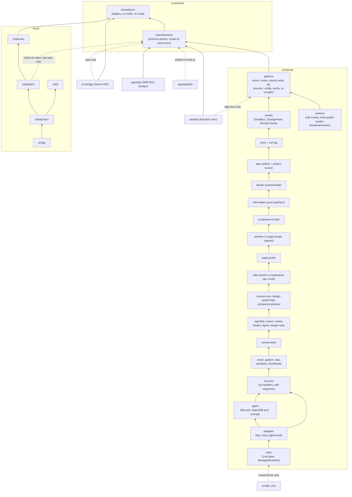

# ADR 0010: Enforced layers, one operation contract, and Effect on the server

- Status: Proposed
- Date: 2026-10-31
- Deciders: Tyler Sheffield
- Executable plan: `.claude/goal/architecture-plan.md` (revision 2)
- Wave order with ADR 0011: `.claude/goal/roadmap.md`

## Context

The app has no enforced architecture. Measured on `main` at `8d686b0`, re-checked at `f16f58e` (publish backend merged):

- **No lint or format tool.** No eslint, biome, oxlint or prettier config. Scripts are only `typecheck`, `test` and `e2e`.
- **One tsconfig for everything.** `tsconfig.json` (20 lines) gives `src`, `e2e`, `scripts` and `desktop` both `lib DOM` and `types [node]`. UI code type-checks against Node, and server code against the DOM.
- **Coarse separation already holds.** `src/ui` imports only `src/shared` and npm packages. No file in `src/server`, `src/bridge`, `src/shared` or `desktop` imports `src/ui`. The coarse rule has 0 violations today.
- **Server areas are tangled.** About 30 two-way pairs exist between server folders (for example store<->app, store<->direct-edit, direct-edit<->components, preview<->export, agent<->mcp, http<->publish).
  - **Runtime SCC:** a 17-file runtime SCC (agent -> mcp -> variations -> agent) holds only because `src/server/mcp/edit-kit.ts:14` is an `import type`.
  - **File-level SCCs:** there are 4: token-history<->create-token, versions<->version-seed, canvas/service<->links, and preview render-playwright -> render-electron -> render-backend.
- **One operation, three implementations.** A UI action goes UI -> HTTP route. The same action from MCP goes MCP -> in-process HTTP loopback (`studioCall`/`studioFile`, 111 refs in `mcp/edit-deps.ts`). From the agent it goes straight to the domain module.
  - **Duplicates:** 18 agent/MCP tool pairs implement the same operation twice (1,331 + 1,362 LOC).
  - **Error contract:** nothing checks that the paths and JSON error shapes agree. `edit-deps.ts` reads `error` as a code, but `app.onError` (`http/app.ts:556`) writes the message there.
- **Hidden global state.** Module singletons hold the change feed, render wait, save queue, layer ids, about 15 caches, and `configureFrameStates` / `configureLayerLocks`. These singletons are set only inside route registration.
  - **Edit origin:** version origin `mcp` works only because the loopback runs inside the `edit-origin.ts` AsyncLocalStorage chain.
- **Errors are untyped.** About 410 swallowed catches exist on the server. `store/errors.ts` (97 importers) and `direct-edit/errors.ts` put HTTP status inside domain errors.
- **Low test coverage.** `mcp` (53 files), `publish` and `share` have no tests. The project rule is to check behavior in the running app.

Tyler asked for crisp, enforced boundaries, with an opinionated framework, Ultracite with all rules on oxlint, and tsrs.

## Decision

1. **Tooling first.** Ultracite 8.1.0 runs on the oxlint backend with every preset that fits the stack: core, react, vitest, playwright, the js-plugins (github, jsdoc-js, sonarjs, tsdoc, react-doctor), anti-slop, and the 64 rules that core leaves off.
   - **Formatter:** oxfmt 0.74.x.
   - **Type checkers:** tsrs runs beside tsc as a non-gating check. tsc 5.9.3 stays the gate, run only through `pnpm run typecheck` (this machine's agent hook denies raw `tsc --noEmit`). The swap criterion needs TypeScript 7, which no phase installs, so the swap is a decision for Tyler: add a TS 7 upgrade slice, or make tsrs the gate now.
   - **Comment rules:** 3 rules require comments, which conflict with the no-comments policy. They are off by default and need Tyler's confirmation.
   - **Ratchet:** a per-rule JSON baseline (the lint gate) blocks any rule count from going up.
   - **One upward re-baseline:** the oxfmt commit `53395f7` raised the baseline once, from 122,095 to 129,727. The formatter made lines longer, so size rules rose: `max-lines` 26 to 128, `max-lines-per-function` 151 to 380, sonarjs `max-lines` 20 to 115, sonarjs `max-lines-per-function` 101 to 251, `require-readable-spacing` 20,521 to 27,568, react-doctor `no-giant-component` 1 to 5. This is the only exception. From now on `lint:gate --update` writes the baseline only when no count rises.
   - **Day-one pairs from the re-baseline:** the same commit, and the type-aware regeneration after it, added 541 rule-file pairs at warn to `lint/day-one.ts` and removed 19, against `83c96d5`. The added pairs: `max-lines-per-function` 159, sonarjs `max-lines-per-function` 104, `max-lines` 102, sonarjs `max-lines` 95, `require-readable-spacing` 32, `unicorn/no-nested-ternary` 7, react-doctor `no-giant-component` 4, and 38 type-aware pairs. Most cover files that crossed the size limits only because of the reformat, for example `src/server/mcp/server.ts`, `src/server/mcp/tools.ts` and `src/server/direct-edit/jsx.ts`. These pairs are P8 scope. Each P8 split re-runs `pnpm run lint:day-one`, so a pair drops and its rule is back at error in that file once the file has 0 hits.
   - **Day-one is type-aware:** `pnpm run lint:day-one` always runs both the native pass and the `--type-aware` pass. A native-only run drops the type-aware pairs, and `pnpm run lint:types` then fails with thousands of errors while `lint:gate` (native, counts only) still passes.
   - **Size limits stay:** `max-lines` stays at 500 and `max-lines-per-function` at 80. The formatted tree is the tree that P8 splits, so the limits are not raised to absorb formatter growth. P8 accepts the larger split scope: about 100 more files and about 230 more functions.
   - **Day-one levels:** a rule is an error on day one only where it has 0 hits. Every rule with hits starts at warn in the baseline and flips to error in the commit that takes it to 0. Complexity is capped at 20 on both cognitive and cyclomatic, the same as the cccc commit hook.
2. **A fixed layer graph, enforced by four tools. Each tool has one job:**
   - **eslint-plugin-boundaries 7.4.0** (through oxlint jsPlugins) owns the fine layer graph. The fine policies start in a shrinking legacy override list.
   - **oxlint `no-restricted-imports`** owns the coarse ui/server/shared/bridge/desktop ban (an error from day one, with 0 violations today, kept out of the legacy list), the public-index-only rule, the npm-per-layer bans (no value import of `effect` or `zod` in the UI and bridge), and platform globals.
   - **`import/no-cycle`** owns cycles. It starts at warn (5 runtime SCCs hit today), with `ignoreTypes: true`. It becomes an error for the server when the cycle-break phase ends, for the UI when the UI phase ends, and covers type imports (`ignoreTypes: false`) once the agent and MCP adapters are rebuilt.
   - **Per-platform tsconfig project references** own DOM and Node API purity. They land last, with a separate DOM-lib project for the server files that run in-page probe code (35 by grep on `f16f58e`, plus up to 9 that use DOM types only; the list comes from a `lib: [ES2023]` dry run), a desktop-renderer project, and a UI-test project.
3. **One action definition (`defineAction`)** per studio action, written in Effect Schema under `src/shared/actions/<domain>/`. A `Handlers<typeof Actions>` map must cover every action.
   - **Consumers:** the HTTP mount, the MCP registry and the agent-tools registry all read the same handler map. A missing route or tool then fails typecheck.
   - **UI:** the UI value-imports a generated, effect-free `routes.ts` and type-imports the op types. This costs 0 bytes of Effect.
   - **Errors:** wire errors are `{_tag, error, message, code?, data?}`, so today's readers keep working.
4. **Effect 4.1.1 on the server only**, with stable modules only: Effect, Layer, Context.Service, Data, Scope, Stream, PubSub, Config, ManagedRuntime, Logger and Schema.
   - **Runtime:** one ManagedRuntime per process, run only at the edges (HTTP, MCP, agent tools, worker entries). Hono stays.
   - **Not Effect:** the UI, the bridge, pure source-edit engines, desktop and scripts stay plain TypeScript.
5. **Migration by strangling.**
   - **Shims:** every move leaves a re-export at the old path.
   - **Facades:** every converted service keeps a Promise facade until its last caller converts.
   - **Swallowed catches:** every swallowed catch becomes an explicit `Effect.orElseSucceed` that returns the same fallback value.
   - **Shim removal:** a final sweep deletes the shims.

### Layer graph

An arrow means "may import". A domain layer may import any layer below it, but only through that area's `index.ts`. Adapters must not import each other.

## Consequences

**Good:**

- **Lint catches crossings.** Cross-layer imports, cycles, deep imports and Effect in the UI bundle fail lint. Typecheck does not have to catch them.
- **UI and MCP cannot drift.** A UI action that has no MCP tool, or a route whose path differs from its client, fails `tsc`.
- **MCP calls services directly.** MCP stops depending on HTTP URL strings and JSON error text. The loopback and the 18 duplicate tool pairs go away.
- **Shutdown cleans up.** Long-lived resources (MCP server, share listener, dev servers, git cat-file, watchers) become scoped Layers. Shutdown stops them, which `index.ts:88-97` does not do today.
- **The ratchet keeps progress.** The per-rule gate stops regressions while the 85,516 first-run diagnostics burn down.

**Bad or risky:**

- **Churn.** There is large rename churn: the formatter touches about 1,243 files, and the shims and barrels have about 590 importers. Merges conflict with open worktree branches. The formatter and the big moves need quiet windows.
- **Behavior can change.** Typed errors will surface failures that are swallowed today. Each slice must keep today's fallback values.
- **No automated guard.** No tests protect mcp, publish or share. Their security checks (bearer and host checks, env scrub, token hash, LAN bind, PBKDF2 10k rounds) must be kept line for line and checked in the app.
- **Two checkers can disagree.** tsrs, oxlint-tsgolint and tsc can report different errors (TS 7.1 beta rules against TS 5.9.3). Only tsc gates until the swap criterion holds.
- **New learning cost.** Contributors must learn the Effect v4 APIs (Context.Service, Schema.TaggedError). The v3 names are banned by lint.

**Not chosen:**

- **No Effect runtime in the UI.** It measured about 100 KB gzip on a 411,722 B Studio chunk.
- **No unstable Effect modules.** effect/http-api, HttpRouter, effect/process and FileSystem are unstable.
- **No package `exports` or monorepo split.** It adds config, and lint already gives the same checks.
- **No husky or lefthook.** They turn off or overwrite the global hooks.
- **No `ultracite init --hooks claude` or `--agents claude`.** They write `.claude/settings.json`, `AGENTS.md` and `CLAUDE.md`, which Tyler did not ask for.
- **No hook bypass by default.** Commits pass the global cccc and no-comments hooks. The vendored `src/ui/ai/**` (the only files with comments, all third-party attributions) is never formatted or autofixed, so its comment lines never count as added.
